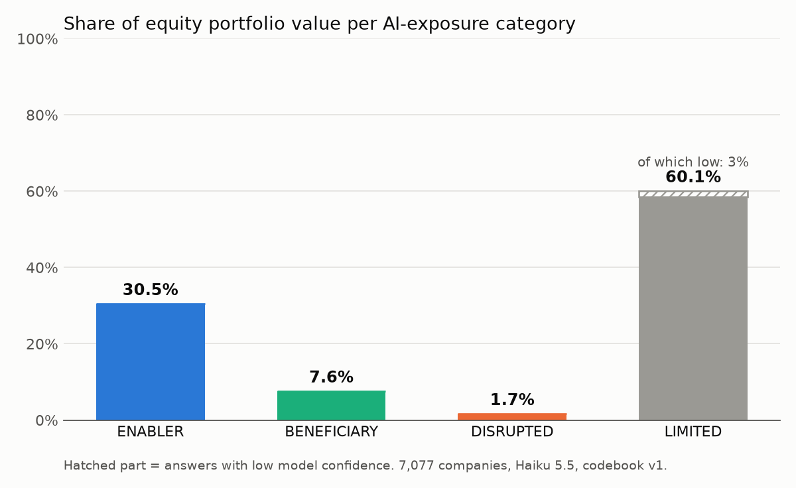
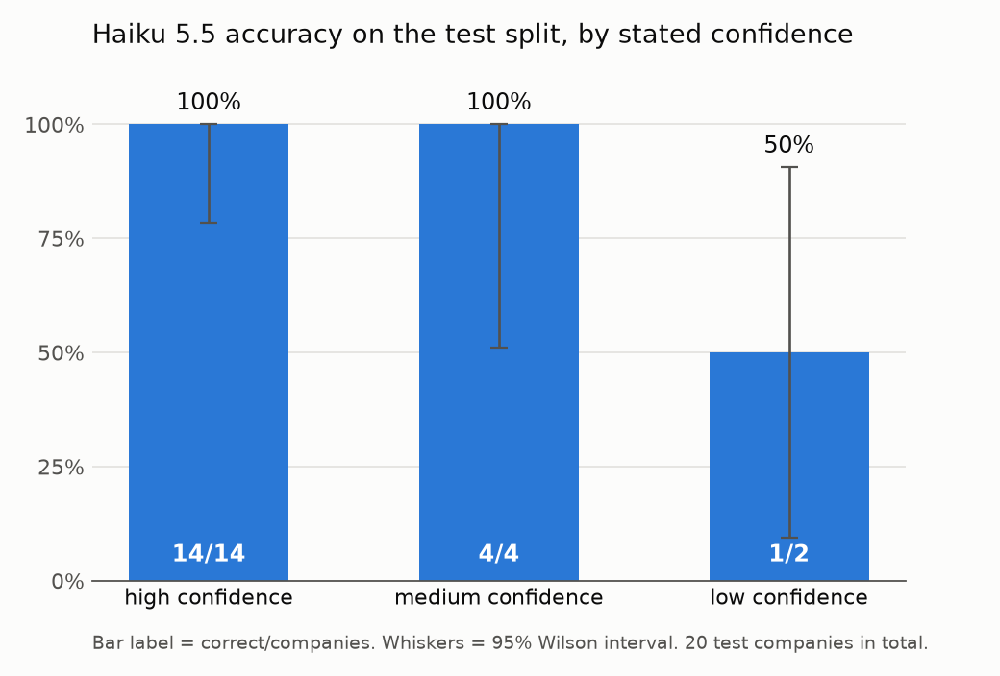

# nbim-ai-exposure

**About 38% of the fund's equity value sits in companies that sell or benefit from AI, but the figure is driven by a few giant holdings: nine of the ten largest are ENABLERS.**
ENABLER 30.5% + BENEFICIARY 7.6% = 38.2% of NOK 16.44 trillion. DISRUPTED is 1.7% and LIMITED is 60.1%. The ten largest holdings are 20.9% of the portfolio.

This is a small research project. A language model (Claude Haiku 5.5) classified all 7,077 equity holdings of Norway's Government Pension Fund Global by AI exposure. I then checked how far the model can be trusted against 40 companies I labelled by hand. The point is the evaluation, not the classifier.





## Method

1. **Data.** NBIM's equity holdings at 30.06.2026: 7,077 companies, NOK 16.44 trillion in total. Each company has a name, country, industry and market value.
2. **Codebook v1.** Four categories, applied in this order: ENABLER (sells what AI runs on), DISRUPTED (core revenue could be replaced or squeezed by AI), BENEFICIARY (AI improves the product or cost base), LIMITED (AI is not a top-three driver). The codebook is also the system prompt: [docs/codebook.md](docs/codebook.md).
3. **Model.** Claude Haiku 5.5, one request per company: dev and test one by one, the full run through the Batch API. It saw only name, country and industry. It answered in a fixed JSON schema: category, confidence (high/medium/low), knows_company and a one-sentence rationale. Claude Sonnet 5.5 was run on the test split for comparison.
4. **Labels.** 40 companies drawn with seed 42: 20 from the 500 largest holdings and 20 from the rest. Within each size group, 10 are dev and 10 are test. I labelled them by hand.
5. **Evaluation.** Accuracy against my labels, with 95% Wilson intervals, compared with a baseline that always answers LIMITED. The codebook was not changed after the first model run, and the test split was run once.

## Results

Test split, 20 companies:

| | Haiku 5.5 | Sonnet 5.5 | Always LIMITED |
|---|---|---|---|
| Correct | 19/20 | 19/20 | 16/20 |
| Accuracy | 95% | 95% | 80% |
| 95% Wilson interval | 76–99% | 76–99% | 58–92% |
| Non-LIMITED companies found (4 in total) | 3 | 3 | 0 |

- Both models made the same single error: UNISOL Holdings (Japan). I labelled it BENEFICIARY with low confidence. Both models did not recognise it, said LIMITED, and flagged low confidence and knows_company=false.
- **Confidence.** Haiku was right on 14/14 high-confidence answers, 4/4 medium and 1/2 low. These counts are far too small to call the confidence "calibrated". They only show that nothing contradicts it.
- **Unknown companies.** In the full run the model said it did not know 21.6% of the companies. They hold only 1.7% of the portfolio value.
- **Dev split.** Haiku got 19/20. The error was Deere & Co (see below).
- **Cost.** The full run of 7,077 companies cost about USD 0.50 at batch prices. All other runs together cost under USD 0.10.

Full tables, the 15 largest companies per category and a random spot check are in [results/summary.md](results/summary.md).

## Limitations

- There is no DISRUPTED company in my labelled set. DISRUPTED is not validated at all.
- Only 20 test companies. One error moves accuracy by 5 percentage points, and the models are not separable at this size.
- I made the labels without AI help, but thoroughness was not a high priority. The main goal was to learn how the method works. The labels are a rough benchmark, not a gold standard.
- The model had no web search and no tools. It saw only company name, country and industry, and answered from its training data (knowledge cutoff June 2026). Companies it did not know were flagged with knows_company=false.
- The word limit on the rationale (25 words) was changed from an error to a warning after the test run. Some answers are longer than the limit and are flagged in the data. The categories were not affected.
- The 40 sample companies were classified again in the full run and may differ slightly from the test files.
- A 30-company spot check of DISRUPTED and BENEFICIARY answers was read against the model's rationale. It was not independently researched.
- The summary numbers are model answers, not facts about the companies.
- Apple (3.17% of the portfolio) is a borderline call that moves the headline.
- Industry labels come from NBIM's classification. For example, Samsung is listed as Telecommunications and Amazon as Consumer Discretionary.

## Borderline cases

- **Alphabet** is ENABLER because the codebook puts selling compute first for hyperscalers, even though a large part of its revenue is advertising. The rule order decides this one.
- **Apple** is BENEFICIARY with medium confidence. The model's own rationale says reasonable people could choose LIMITED. At 3.17% of the portfolio, this one call moves the headline.
- **Deere & Co** is the one dev error. I labelled it LIMITED. The model said BENEFICIARY because of AI-enabled precision farming. It is a judgement call, and the data does not settle it.

## Disclaimer

Not made by or with NBIM. Based on their public holdings data.

## How to run

```bash
python -m venv .venv
.venv\Scripts\pip install -r requirements.txt     # macOS/Linux: .venv/bin/pip
cp .env.example .env                              # add FUND_AI_ANTHROPIC_KEY, never commit .env
```

Put NBIM's equity holdings file (`eq_20260630.csv`) in `data/raw/`. It is not committed.

```bash
python src/load_holdings.py                       # data/holdings_equities.csv
python src/make_sample.py                         # data/labels/sample.csv (labels are in the repo)
python src/classify.py --split dev                # --model, --split dev|test|all|smoke|fund, --batch
python src/evaluate.py results/claude-haiku-5-5_dev_v1.jsonl --split dev
python src/analyze.py                             # results/summary.md and figures
```

`classify.py` resumes if it stops, asks before runs that include the test split, and shows a cost estimate before batch runs. Do not re-run `make_sample.py` with `--force`: it overwrites the hand labels.
